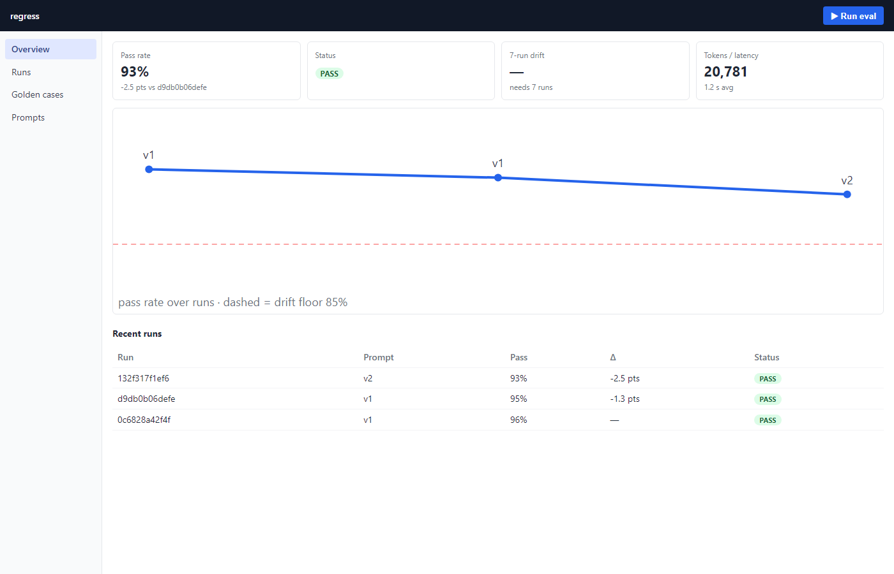
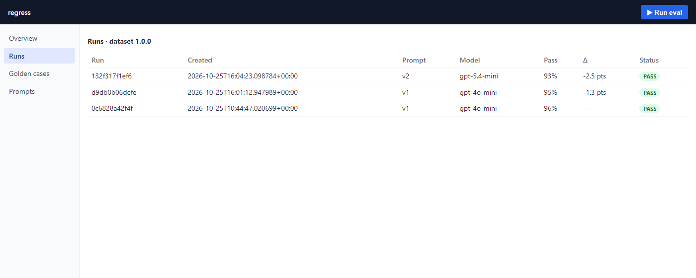
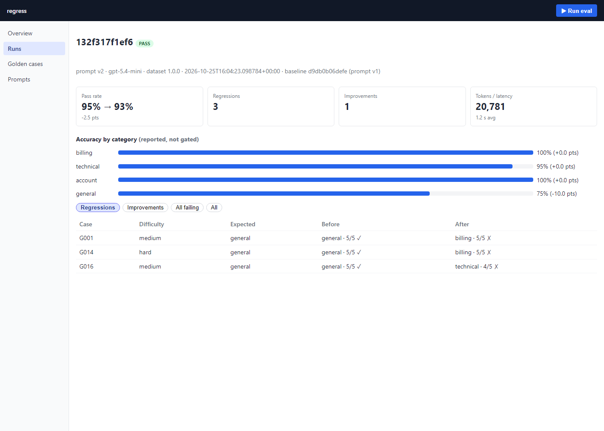
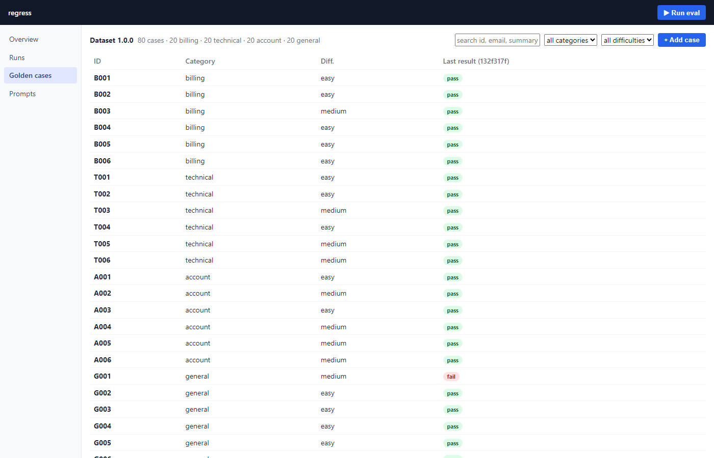
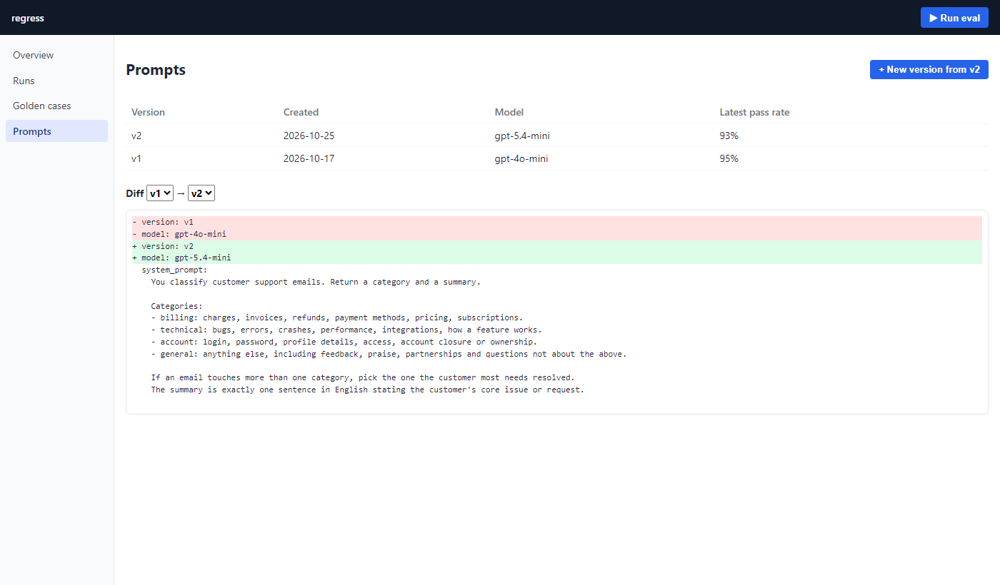
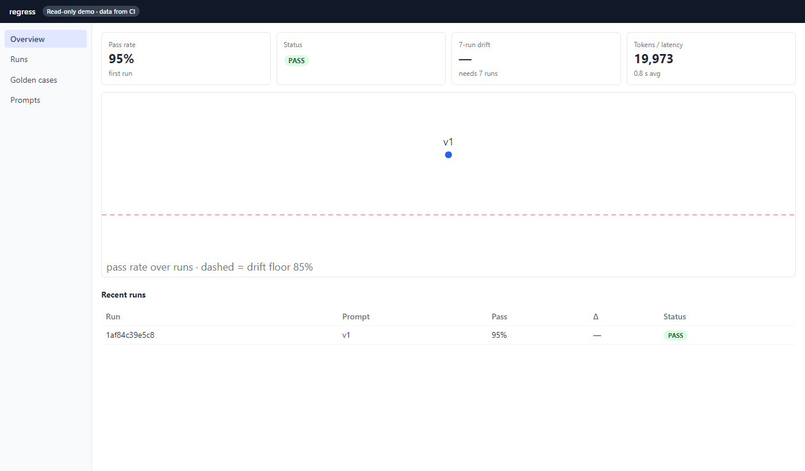

# Model Regression Detection System

CI/CD-style regression testing for an LLM feature. Every prompt or model change runs against a hand-labeled golden dataset. Each case is scored, the run is diffed against the previous one, and the results go out as an HTML report, a Slack alert, a PR comment and a web dashboard. A critical regression fails the PR check.

**Live demo:** https://mandpeganesh.github.io/Model-Regression-Detection-System/ (read-only, rebuilt from CI history after every eval)



## Contents

- [What it tests](#what-it-tests)
- [How it works](#how-it-works)
- [Setup](#setup)
- [Running an eval (CLI)](#running-an-eval-cli)
- [Dashboard](#dashboard)
- [Golden dataset](#golden-dataset)
- [Prompts](#prompts)
- [Configuration](#configuration)
- [CI/CD](#cicd)
- [Docker](#docker)
- [Project layout](#project-layout)
- [Testing](#testing)
- [Design decisions](#design-decisions)
- [Troubleshooting](#troubleshooting)

## What it tests

The feature under test is a customer-support email classifier: email text in, JSON `{category, summary}` out.

- `category` is one of `billing | technical | account | general`.
- `summary` is one sentence stating the customer's core issue.
- The feature is one Python function (`classify_email` in `src/regress/feature.py`). The prompt is a parameter loaded from `prompts/*.yaml`, never hardcoded. `PromptConfig` (in `config.py`) is the interface contract.

## How it works

```
prompts/*.yaml ──┐
data/golden.json ┼─> runner (async, concurrency cap, retries) ──> per-case scores ──> runs.db (SQLite)
                 │      classify_email ─ OpenAI structured output        │
                 │      judge_summary  ─ DeepEval GEval (1–5)            │
                 │                                                       v
                 └──────────────> compare (vs previous run) + drift (moving average)
                                         │
              ┌──────────────┬───────────┼──────────────┬───────────────────────┐
              v              v           v              v                       v
        HTML report    PR summary     Slack alert   exit code (0/1/2)   snapshot.json ─> dashboard
```

Every case is scored on every dimension, and all of them are stored per case, per run:

| Dimension | How | Pass rule |
|---|---|---|
| Category | Exact match against the golden label | must match |
| Summary relevance | LLM-as-judge (DeepEval GEval), scored 1–5 against the golden summary | `>= RELEVANCE_PASS_MIN` (default 3) |
| Latency | Wall-clock time of the OpenAI call | recorded, not gated |
| Tokens | Prompt + completion tokens | recorded, not gated |

A case passes when its category is right **and** relevance meets the minimum. The run's pass rate is passed / total.

Each run is then compared with the **previous run on the same dataset version**:

- overall pass-rate change, which decides the status (see [Thresholds](#thresholds));
- per-category accuracy change (reported, not gated);
- **regressions**: cases that went pass → fail;
- **improvements**: cases that went fail → pass.

Separately, **slow drift** tracks the moving average of the last `DRIFT_WINDOW` runs against an absolute floor (see [Why slow drift is separate](#why-slow-drift-is-tracked-separately)).

## Setup

Requirements: Python 3.11+, an OpenAI API key, and Node 22 if you want to build the dashboard.

```bash
python -m venv .venv
.venv/Scripts/activate              # Windows; use: source .venv/bin/activate on Linux/macOS
pip install -e ".[dev]"             # CLI + test tools
pip install -e ".[dev,ui]"          # also FastAPI/uvicorn for the dashboard's owner mode
cp .env.example .env                # then fill in OPENAI_API_KEY (and SLACK_WEBHOOK_URL if wanted)
```

| Extra | Installs | Needed for |
|---|---|---|
| (none) | `openai`, `deepeval`, `pydantic`, `pyyaml` | `regress run`, `regress export` |
| `dev` | `pytest`, `httpx` | running the tests |
| `ui` | `fastapi`, `uvicorn` | `regress serve` (dashboard owner mode) |

Settings are read from the process environment only. Load `.env` into your shell before running:

```bash
# Git Bash / Linux / macOS
set -a; . ./.env; set +a
```

```powershell
# PowerShell
Get-Content .env | Where-Object { $_ -match '^\s*[^#].*=' } | ForEach-Object {
  $k, $v = $_ -split '=', 2; Set-Item "env:$($k.Trim())" $v.Trim()
}
```

## Running an eval (CLI)

The CLI has three commands: `run`, `export` and `serve`.

### `regress run`

```bash
python -m regress run               # newest prompt in prompts/, data/golden.json, runs.db, reports/
```

| Option | Default | Meaning |
|---|---|---|
| `--prompt PATH` | newest `created_at` in `--prompts-dir` | Evaluate a specific prompt file |
| `--prompts-dir DIR` | `prompts` | Where prompt versions live |
| `--dataset PATH` | `data/golden.json` | Golden dataset |
| `--db PATH` | `runs.db` | Run history; the previous run here is the baseline |
| `--out DIR` | `reports` | Where reports are written |
| `--record-to PATH` | (none) | Save the run to this DB as a **PR run** instead of into `--db`. The baseline still comes from `--db`. Used by CI. |
| `--pr-number N` | (none) | PR number for `--record-to` |
| `--head-sha SHA` | (none) | PR head commit for `--record-to` |

`--record-to`, `--pr-number` and `--head-sha` go together: all three or none.

Every run writes:

- `reports/<run_id>.html`: the full diff report (scorecard, per-category accuracy, regressed cases with old and new output, trend chart);
- `reports/summary.md`: the short summary CI posts on the PR;
- a Slack message, if `SLACK_WEBHOOK_URL` is set (a Slack failure only logs a warning);
- the summary to stdout.

| Exit code | Meaning |
|---|---|
| 0 | pass or warn |
| 1 | critical regression |
| 2 | bad config, bad data, or an OpenAI failure. **Nothing is stored.** |

### `regress export`

Builds the JSON snapshot the dashboard renders: all runs with per-case results, their comparisons and drift (computed in Python), the golden dataset, every prompt version, and the threshold settings. No secrets are included.

```bash
python -m regress export --db runs.db --out frontend/public/data/snapshot.json
python -m regress export --db history/runs.db --pr-db history/pr-runs/*.db --out snapshot.json
```

| Option | Default | Meaning |
|---|---|---|
| `--db PATH` | `runs.db` | Main run history. A missing file means "no runs" (it is not created). |
| `--pr-db PATH ...` | none | PR run DBs, one per PR run |
| `--dataset PATH` | `data/golden.json` | Golden dataset to include |
| `--prompts-dir DIR` | `prompts` | Prompt versions to include |
| `--out PATH` | required | Output JSON file |

### `regress serve`

Starts the dashboard in owner mode. See [Owner mode](#owner-mode-local). Options: `--port` (default 8000), `--dataset`, `--prompts-dir`, `--db`, `--out`, with the same defaults as `run`. **Run it from the repo root**, because it serves `frontend/dist` relative to the current directory.

## Dashboard

A React dashboard over the run history. It runs in two modes from one build:

| | Public demo | Owner mode |
|---|---|---|
| Where | GitHub Pages | your machine, `http://127.0.0.1:8000` |
| Data | CI history (`eval-history` branch) | your local `runs.db`, `data/golden.json`, `prompts/` |
| Server | none (static files + `snapshot.json`) | `python -m regress serve` (FastAPI, localhost only) |
| Can change things | no | start runs, add/edit golden cases, create prompt versions |
| Needs an API key | no | yes, for runs |

### Screens

**Overview.** Latest pass rate and change, status, 7-run drift, tokens and latency, the pass-rate trend with the drift floor dashed, recent runs, and (when there are PR runs) a "Pull requests" panel marking each PR as passed or blocked. With several dataset versions, a selector picks which one to show; trends and drift restart per version.

**Runs.** Every run for the selected dataset version with prompt, model, pass rate, change and status.



**Run detail.** Run metadata and its baseline, pass rate old → new, regression and improvement counts, per-category accuracy bars with their change, and a case table filterable by Regressions / Improvements / All failing / All. Expanding a row shows the email, the expected summary, the before and after summaries, any error, and the case notes. Case text is only shown for runs on the current dataset version. PR runs open here too, labelled "PR #N · not merged into history".



**Golden cases.** Search by id, email or summary, filter by category and difficulty, and see each case's result in the latest run. In owner mode, **+ Add case** and the edit panel write `data/golden.json` (see [Editing from the dashboard](#editing-the-golden-dataset-from-the-dashboard)).



**Prompts.** Every prompt version with its model and latest pass rate, and a line diff between any two versions. In owner mode, **+ New version from vX** opens an editor pre-filled from that version and saves a new `prompts/<version>.yaml`.



**Run eval** (owner mode, top bar). Pick a prompt version, start the run, watch `done / total` progress, and land on the new run's detail page. One run at a time. Closing the dialog doesn't stop the run; reopening it resumes the progress view.

### Public demo



The demo is rebuilt by `.github/workflows/site.yml` after every eval workflow run and whenever `frontend/` or `src/regress/snapshot.py` changes on `main`. It is read-only: the Run eval and edit controls aren't rendered, and there is no server to call.

One-time setup: repo **Settings → Pages → Source: GitHub Actions**.

### Owner mode (local)

```bash
pip install -e ".[ui]"
# load .env into the shell (see Setup)
cd frontend && npm ci && npm run build && cd ..
python -m regress serve             # from the repo root; open http://127.0.0.1:8000
```

The owner API binds to `127.0.0.1` only. Its write endpoints accept requests only from localhost pages (checked via the `Origin` header), so other websites can't drive it. Your API keys stay on the server and never reach the browser.

| Endpoint | Purpose |
|---|---|
| `GET /api/snapshot` | Everything the UI shows (same JSON as `regress export`) |
| `POST /api/runs` `{prompt_version}` | Start a run in the background (409 if one is running) |
| `GET /api/runs/current` | `{state, done, total, run_id, error}` for the progress bar |
| `POST /api/golden/cases` `{case, new_version}` | Add a golden case |
| `PUT /api/golden/cases/{id}` `{case, new_version}` | Edit a golden case |
| `POST /api/prompts` `{version, model, system_prompt, few_shot_examples}` | Create a new prompt version |

A run started from the dashboard goes through the same pipeline as `regress run`: it is saved to `runs.db`, writes the HTML report and summary, and posts to Slack if configured.

### Frontend development

```bash
python -m regress serve             # terminal 1, repo root
cd frontend && npm run dev          # terminal 2; Vite proxies /api to the server
```

The frontend is React + Vite + TypeScript with no other runtime libraries: routing is hash-based (works on Pages), charts are hand-written SVG, styles are plain CSS. `npm run build` type-checks (`tsc --noEmit`) and builds to `frontend/dist`. `VITE_DEMO=1` builds the read-only demo, which loads `./data/snapshot.json`.

## Golden dataset

`data/golden.json` is the ground truth every run is measured against: 80 hand-written cases, 20 per category, version `1.0.0`.

```json
{"version": "1.0.0", "cases": [
  {"id": "B001",
   "input": "Subject: Charged twice for October\nHi team, ...",
   "expected": {"category": "billing", "summary": "The customer was charged twice ..."},
   "expected_difficulty": "easy",
   "notes": "why this case matters"}
]}
```

Rules:

- **Written and verified by a human.** Never generate inputs, labels, summaries or notes with an LLM. Nothing in this project does, including the dashboard.
- **IDs are permanent.** Never rename or reuse an id, because run comparisons key on it.
- **Any change bumps `version`.** Runs are only compared within one dataset version, so the next run after a bump starts a fresh baseline.
- Tag edge cases (two plausible categories, very short emails, typos, mixed languages, sarcasm, prompt injection) as `medium` or `hard`, and say why in `notes`.
- `pytest tests/test_golden_dataset.py` checks the shape: 50–100 cases, all four categories, at least easy and hard cases, notes filled in.

### Editing the golden dataset from the dashboard

Owner mode enforces the rules on the server, whatever the browser sends:

- An edit can't change a case's id; a new case's id must not exist in the file **or** in any past run.
- Every save needs a dataset version. A version is **frozen** once any run has used it or it is the version committed in git; saving changes to a frozen version requires a new one. A version with no runs yet can keep collecting edits, so five edits before a commit make one new version, not five.
- An old version string can never be reused.
- No delete button: removing cases is done by hand, so the "never reuse ids" rule stays safe.
- Writes are refused while a run is in progress, and the file is written atomically.

The dashboard only edits your local files. Commit them and open a PR; CI evaluates golden-dataset changes too.

## Prompts

Prompts live only in `prompts/*.yaml`, and each file is immutable. A change is always a new version file.

```yaml
version: v2
created_at: 2026-11-01T00:00:00Z
model: gpt-4o-mini
system_prompt: |
  You classify customer support emails. ...
few_shot_examples:
  - email: "..."
    output: {category: billing, summary: "..."}
```

- The eval runs the prompt with the newest `created_at` (a tie between two files is an error).
- CI fails any PR that modifies or renames an existing prompt file.
- From the dashboard, **+ New version from vX** creates the file with `created_at` set to now, refuses to overwrite anything, and only accepts version names made of letters, digits, `.`, `_` and `-`.

## Configuration

All settings come from environment variables (`.env.example` lists them). Nothing reads env vars except `Settings.from_env()`.

### Secrets

| Env var | Used for |
|---|---|
| `OPENAI_API_KEY` | The classifier and the judge |
| `SLACK_WEBHOOK_URL` | Slack alerts (optional) |
| `REPORT_URL` | Link to the full report in Slack and the PR comment (CI sets it) |
| `DEEPEVAL_TELEMETRY_OPT_OUT=YES` | Turns off DeepEval telemetry |

Never commit `.env`; it is gitignored.

### Thresholds

| Env var | Default | Meaning |
|---|---|---|
| `WARN_THRESHOLD` | 0.03 | Pass-rate drop (absolute) above which the run warns |
| `CRITICAL_THRESHOLD` | 0.08 | Pass-rate drop above which the run is critical and the PR check fails |
| `DRIFT_THRESHOLD` | 0.85 | Slow-drift alert when the moving average falls below this |
| `DRIFT_WINDOW` | 7 | Runs in the moving average |
| `RELEVANCE_PASS_MIN` | 3 | Minimum judge score (1–5) for a summary to pass |
| `MAX_CONCURRENCY` | 8 | Concurrent OpenAI calls |
| `JUDGE_MODEL` | gpt-4o-mini | Model used as the summary judge |

"Above" means strictly greater: a drop of exactly 3 points is a pass. Invalid values (non-numbers, warn ≥ critical, thresholds outside 0–1) make the CLI exit with code 2.

## CI/CD

### Eval workflow (`.github/workflows/eval.yml`)

Runs on PRs and pushes to `main` that touch `prompts/` or `data/golden.json`, and can be started by hand (`gh workflow run eval.yml --ref main`).

1. **Prompt immutability check** (PRs): fails if an existing prompt file was modified or renamed.
2. **Attach history**: checks out the `eval-history` branch at `history/` (creates it on the first run).
3. **Eval**: on `main`, `regress run --db history/runs.db`; on a PR, the same baseline but the run is recorded to `history/pr-runs/<pr>-<sha>.db`.
4. **Report artifact**: uploads `reports/` as `eval-report`.
5. **Save history**: commits and pushes the new DB file to `eval-history` (skipped on exit 2, which stored nothing). Retries with a rebase if another run pushed first.
6. **PR comment**: posts or updates one summary comment on the PR.
7. **Gate**: the job fails on exit code 1 (critical) or 2 (error), which blocks the merge.

Concurrency: PR runs cancel older runs of the same PR (newest commit wins); `main` runs queue so `runs.db` has a single writer.

Security: checkout stores no credentials, so PR code running during the eval can't use the write token. Only the final push step gets it.

### Run history (`eval-history` branch)

| File | Holds | Baseline? |
|---|---|---|
| `runs.db` | Runs from `main` (merged prompts and datasets) | **yes**, the only baseline |
| `pr-runs/<pr>-<sha>.db` | One file per PR run | never; shown in the dashboard's PR panel |

History is durable: unlike the Actions cache, it never expires.

### Site workflow (`.github/workflows/site.yml`)

Triggered when the eval workflow completes, on pushes to `main` touching `frontend/**` or `src/regress/snapshot.py`, or by hand. It exports a snapshot from the `eval-history` branch, builds the dashboard with `VITE_DEMO=1`, and deploys it to GitHub Pages.

### Repository setup

| Setting | Where | Required |
|---|---|---|
| `OPENAI_API_KEY` | Settings → Secrets and variables → Actions → Secrets | yes |
| `SLACK_WEBHOOK_URL` | same, Secrets | optional |
| Threshold variables (`WARN_THRESHOLD`, …) | same, Variables | optional; unset ones use defaults |
| Pages source | Settings → Pages → Source: **GitHub Actions** | for the public demo |

Fork PRs don't get secrets, so their eval exits with code 2.

## Docker

The image runs the CLI only (no dashboard).

```bash
docker build -t regress .
docker run --rm --env-file .env -v "$PWD/state:/state" regress
```

Run history and reports go to `./state` (`/state/runs.db`, `/state/reports`). Keep that directory between runs so each run has a baseline.

## Project layout

```
prompts/vN.yaml               versioned prompts (immutable; newest created_at is evaluated)
data/golden.json              golden dataset, hand-written
src/regress/
  config.py                   PromptConfig contract, ClassificationResult, Settings.from_env, prompt lookup
  feature.py                  classify_email (the feature under test)
  dataset.py                  golden dataset schema + loader
  judge.py                    DeepEval GEval summary relevance, 1-5
  runner.py                   async eval run, per-case scoring, progress callback
  store.py                    SQLite run history (main runs + PR runs)
  compare.py                  previous-run diff, thresholds, slow drift (pure logic)
  report.py                   HTML report + PR markdown summary
  slack.py                    Slack webhook
  snapshot.py                 dashboard JSON snapshot (build_snapshot)
  edits.py                    ground-truth guards for golden and prompt edits
  api.py                      local owner API (FastAPI)
  cli.py                      `python -m regress run | export | serve`
frontend/                     React + Vite + TypeScript dashboard
  src/pages/                  Overview, Runs, RunDetail, Golden, Prompts
  src/components/             StatusTag, Tiles, TrendChart, RunEvalDialog
  src/data.ts                 snapshot loading + owner API client
tests/                        pytest; fakes.py holds the fake OpenAI client, fixtures/ is synthetic
docs/                         design specs, plans, screenshots
.github/workflows/eval.yml    eval on prompt/golden changes, history, PR gate
.github/workflows/site.yml    public dashboard deploy
Dockerfile
```

## Testing

```bash
pytest                              # 134 tests, no network calls
cd frontend && npm run build        # type-check + build
```

Unit tests never call OpenAI or Slack: `tests/fakes.py` provides a fake client. The comparison, threshold and drift logic is covered closely (a bug there means silent false passes), as are the edit guards that protect the golden dataset and prompts.

## Design decisions

- **Every case is scored on every dimension.** Category, relevance, latency and tokens are all stored per case, per run.
- **Only the overall pass rate gates the check.** Per-category accuracy and its change are reported but don't block: with about 20 cases per category, one flip moves a category by 5 points, which is too noisy to fail a build on.
- **"Exceeds" means strictly greater.** A drop of exactly 3 points passes. Drops are rounded before comparing, so floating-point noise (`0.94 - 0.91 = 0.030000000000000027`) can't create false warnings.
- **Comparisons stay within one dataset version.** Changing the cases moves the bar, so pass rates from different versions aren't compared.
- **API outages never become baselines.** If an OpenAI error survives the client's retries, the run aborts with exit code 2 and nothing is stored. Otherwise an outage would be recorded as a 0% run and the next good run would look like a huge improvement. Model-behaviour failures (a refusal, unparseable or truncated output) fail only that case.
- **Only `main` sets the baseline.** PR runs are recorded separately and never become the baseline for the next PR. A PR run is compared with the `main` run that was latest when the PR ran, so the dashboard always agrees with the PR check.
- **Logic stays in Python.** Status, deltas, pass/fail and drift are computed once in `compare.py`; the dashboard only displays them.
- **Static outputs.** The HTML report and the public dashboard need no server, so they work as a CI artifact and on GitHub Pages.

### Why slow drift is tracked separately

Per-run checks compare against the previous run only. Five prompt changes that each lose 1 point never trip a 3-point gate, yet together they cost 5 points. The drift check watches the moving average over the last `DRIFT_WINDOW` runs and alerts when it falls below an absolute floor, whatever the individual steps looked like. The two signals answer different questions: "did this change break something?" and "are we slowly getting worse?" Drift is reported on its own line and never fails a PR, because no single change caused it.

## Troubleshooting

| Symptom | Cause | Fix |
|---|---|---|
| Dashboard shows `404 Not Found` | `serve` started outside the repo root, or the frontend isn't built | `cd frontend && npm run build`, then run `python -m regress serve` from the repo root. `serve` warns at startup if `frontend/dist` is missing. |
| `error: install with pip install -e .[ui]` | Owner-mode dependencies missing | `pip install -e ".[ui]"` |
| Run eval ends in an error, nothing stored | `OPENAI_API_KEY` not set in the shell that started `serve` | Load `.env` (see Setup), restart `serve` |
| Exit code 2 from `regress run` | Bad env value, invalid dataset/prompt, or OpenAI failure | Read the `error:` line on stderr |
| Public demo says "No runs yet" | No eval has run on CI since history moved to `eval-history` | `gh workflow run eval.yml --ref main`, or merge a prompt/golden change |
| Golden edit rejected with "bump it" | The dataset version is frozen (used by a run or committed) | Enter a new version, e.g. `1.0.1` |
| PR check shows a prompt immutability failure | An existing `prompts/*.yaml` was edited | Revert it and add a new version file instead |
